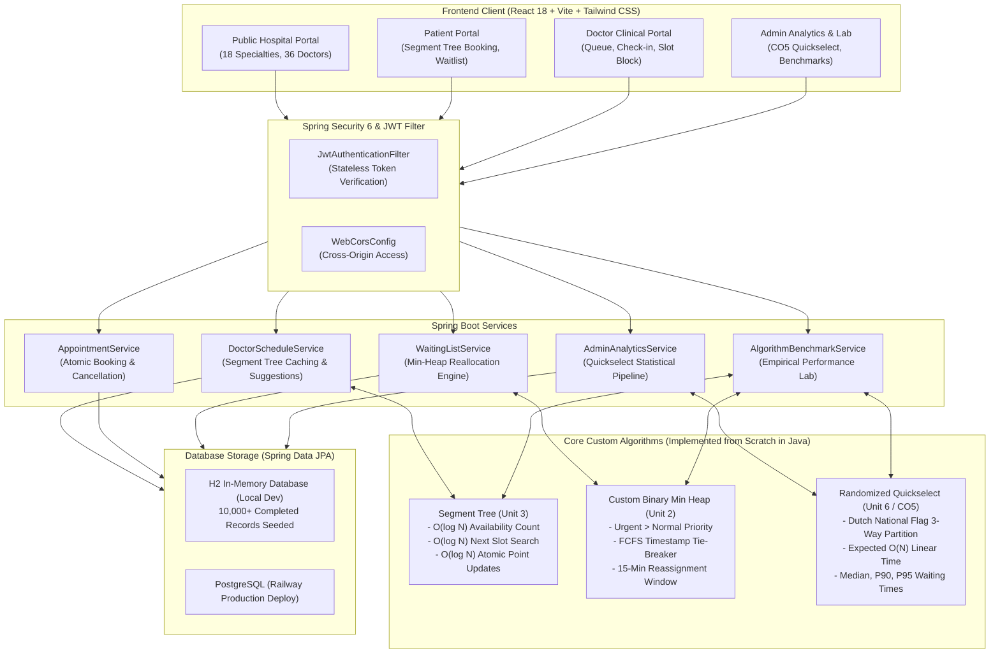
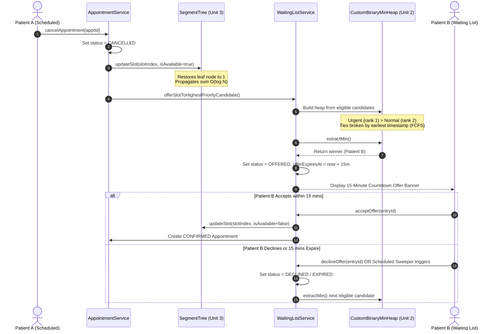
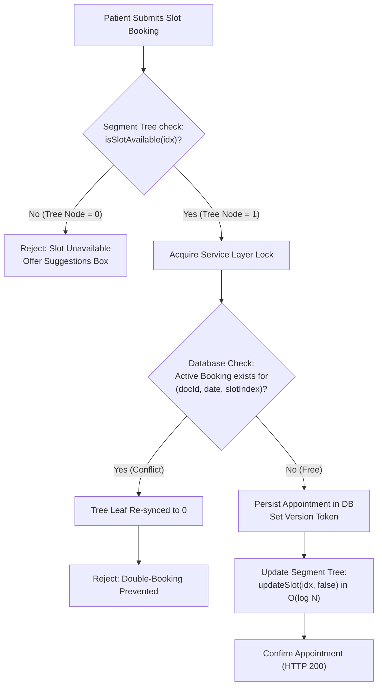

# MediSlot System Architecture & Data Flow Diagrams
**Course:** B.Tech Advanced Algorithms (CIA 3)

---

## 1. High-Level System Architecture

---

## 2. Cancellation & Waiting-List Offer Sequence Diagram

---

## 3. Double-Booking Prevention Flowchart

